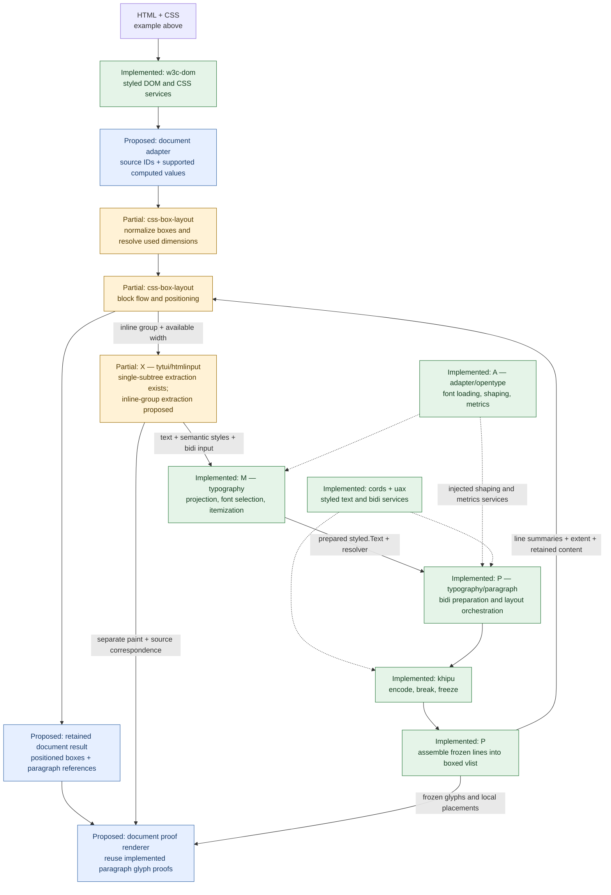
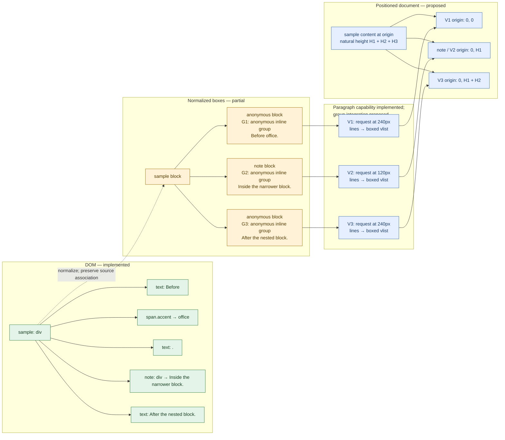

# Three views of document-to-box layout

Planning diagrams, 2026-11-12. Read alongside
[the document-layout exploration](DOCUMENT_LAYOUT_EXPLORATION.md).
They explain the intended integration and distinguish it from what runs today.
Tytui is the laboratory in which we will exercise these boundaries.

**Status legend:** **Implemented** means available for the current supported
paragraph subset, not complete CSS or typography conformance. **Partial** means
code exists but the document use case has unresolved gaps. **Proposed** means the
connection or document feature is not implemented. Status appears in node labels
as well as colors: green = implemented, amber = partial, blue = proposed.
An arrow shows the intended contract; it does not by itself assert working wiring.

## One example for all three views

```html
<style>
  #sample, #note { display: block; margin: 0; padding: 0; border: 0; }
  #sample { width: 240px; }
  #note { width: 120px; }
  .accent { color: red; }
</style>
<div id="sample">Before <span class="accent">office</span>.<div id="note">Inside the narrower block.</div>After the nested block.</div>
```

Treat sample as the experiment's root. This isolates normal block flow without
page, body-margin or border/padding effects. Font selection and paragraph spacing
are explicit experiment inputs, not unspecified promises of browser defaults.
There is deliberately no CSS line-height declaration: that extraction work is
parked. The color should reach rendering without splitting the word's shaping.

The root has inline content before and after a block child. Consequently there
are **three paragraph requests**, although the HTML contains no p element. The
span belongs to the first request, not to a fourth paragraph. This document cannot
yet be laid out end-to-end by tytui: its current paragraph selector rejects nested
blocks, and the proposed document path must discover groups through box layout.

## View 1 — Responsibilities and data flow

This view answers **who owns each transformation?** Solid arrows carry content or
results; dashed arrows denote supplied services. X, M, A and P are architectural
roles, not four new modules to create.



Font discovery is optional input preparation and is omitted here for clarity.
The document renderer will use retained services and payloads; it must not reopen
fonts, reshape text or infer color from a box's geometry.

Current obstacles are style transport and text-source identity in box construction,
computed-value context, coordinate conventions, and retention of paragraph results
for anonymous boxes. The existing InlineLayouter interface is a useful connection
point, not evidence that these obstacles are already solved.

## View 2 — One source, successive representations

This view answers **why are DOM nodes, boxes and paragraphs different objects?**
The DOM structure below is available today. The box structure is the intended
normalization of this example, supported by partial builder machinery. The final
composition is proposed. G1–G3 are explanatory group labels, not runtime IDs.



The G1/G3 anonymous blocks have no corresponding HTML element. The inline span
inside G1 survives as style/source information within that group's text. BoxID
identifies a generated box; NodeID/source ranges preserve document associations.
They cannot be substituted for one another, especially when normalization splits
one element into several fragments.

H1–H3 are returned paragraph extents converted to the outer layout's units. These
are symbolic positions, not predictions of real font metrics or line breaks.
For the initial fake-paragraph experiment, choose H1=24px, H2=36px and H3=12px:
origins are then (0,0), (0,24) and (0,60), and root height is 72px. Those deliberately
supplied values provide a positioning oracle before real typography is connected.
They are not measured output from the HTML above.

## View 3 — Width goes down; height comes back

This view answers **who calls whom, and when does the following block move?**
It describes the proposed document integration using the implemented paragraph
engine. Fake paragraphs can replace P for the first positioning tests.

```mermaid
sequenceDiagram
    participant W as Workbench (document experiment proposed)
    participant B as Box builder / used values (partial)
    participant F as Block flow (partial)
    participant X as Inline-group adapter (proposed)
    participant P as Paragraph P + M/A/khipu (implemented)
    participant R as Document result / proof (proposed)

    W->>B: Styled sample + supported values + root constraints
    B-->>W: Box tree, G1/G2/G3 identities, used widths
    W->>F: Lay out tree with inline adapter
    loop G1 at 240px, G2 at 120px, G3 at 240px
        F->>X: LayoutInline(group, available content width)
        X->>X: Collect normalized text, styles, bidi and source map
        X->>X: Retain paint separately; convert width to paragraph units
        X->>P: Prepared styled.Text + width + policy + injected services
        P->>P: Shape, break, freeze, assemble local lines
        P-->>X: Boxed vlist: extent, baselines, frozen content
        X->>X: Retain group-to-result association; convert line summaries
        X-->>F: Line boxes + retained paragraph references
        F->>F: Position group; advance by its returned extent
    end
    F-->>W: Positioned box geometry
    W->>R: Snapshot geometry, paragraph associations and separate paint
    R->>R: Compose parent transforms once; draw retained glyphs
    Note over F,P: Outer flow positions the vlist; it does not stack its lines again.
    Note over W,R: This document path is proposed. Existing paragraph results remain the control.
```

The callback receives the content width after the relevant box edges have been
resolved. Paragraph output remains in local coordinates. The adapter translates
between box-layout pixel/float32 summaries and paragraph DU/fractional-big-point
geometry; exact conversion and rounding belong in the integration contract.
Preserve precise retained glyph geometry and the vlist's full extent, including
compatibility-policy trailing spacing.

For a resize experiment, change note's width from 120px to 90px. The next layout
must call P with the new width. If its returned height changes from H2 to H2', G3
moves from H1+H2 to H1+H2'. A narrower width does not guarantee a different height;
that depends on the content and breaker. Keep the old document result intact.
Caching and incremental invalidation are later decisions, not requirements of
this first experiment.

## How to use these diagrams to track progress

Update statuses only when the relevant boundary is exercised by an integration
test. Keep the example and its source identities consistent across all three
views. A working isolated package does not make an untested connection implemented.

First prove the fake paragraph widths and positions; then use synthetic typography,
then real fonts and frozen glyph rendering. The target is a continuous document
with natural height, not pagination. DOM line-height extraction, intrinsic sizing,
atomic inline items, margin collapse and the CSS box engine's broader coverage
remain separate follow-up work.

This is documentation only. The diagrams are explanatory contracts and proposed
experiments, not screenshots or captured execution traces.
