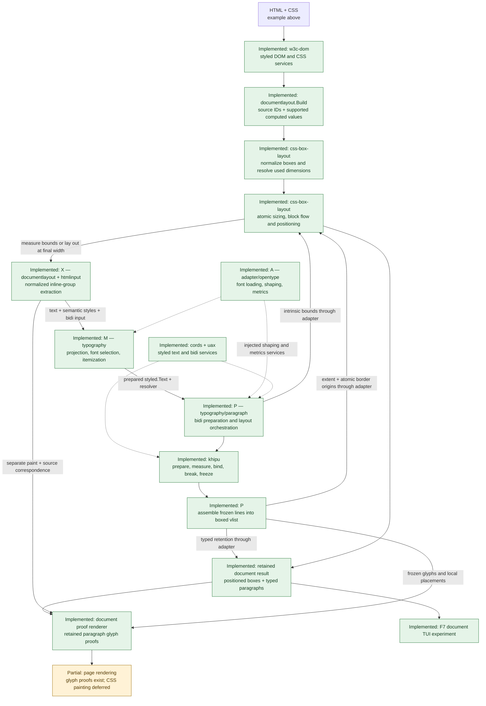
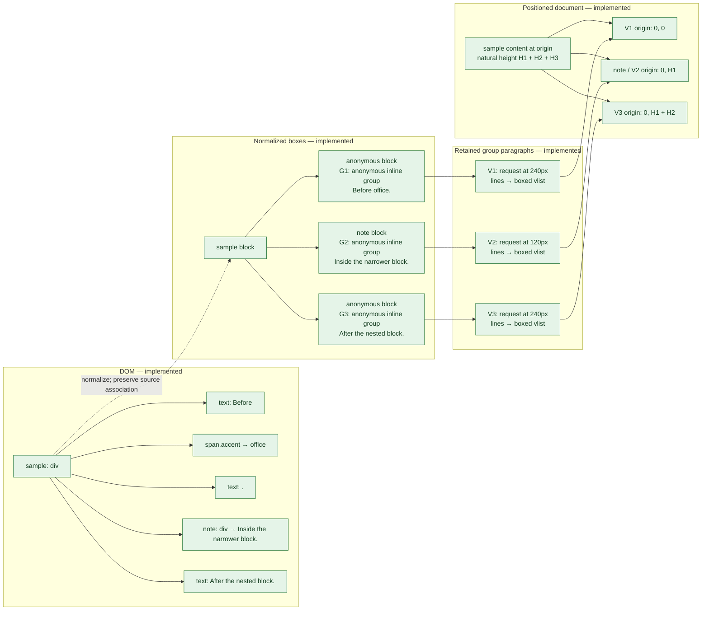

# Three views of document-to-box layout

Started 2026-11-12; updated against the headless path and document TUI on 2026-11-15.
Read alongside [the document-layout exploration](DOCUMENT_LAYOUT_EXPLORATION.md)
and [the current review](INTEGRATION_REVIEW_2026-11-15.md).
Tytui is the laboratory in which we exercise these boundaries.

**Status legend:** **Implemented** means available for the current supported
document subset, not complete CSS or typography conformance. **Partial** means
code exists but the document use case has unresolved gaps. **Proposed** means the
connection or document feature is not implemented. Status appears in node labels
as well as colors: green = implemented, amber = partial, blue = proposed.
An arrow shows the intended contract; it does not by itself assert working wiring.

## One example for all three views

```html
<style>
  #sample, #note { display: block; margin: 0; padding: 0; border-width: 0; border-style: none; }
  #sample { width: 240px; }
  #note { width: 120px; }
  .accent { color: red; }
</style>
<div id="sample">Before <span class="accent">office</span>.<div id="note">Inside the narrower block.</div>After the nested block.</div>
```

Treat sample as the experiment's root. This isolates normal block flow without
page, body-margin or border/padding effects. Font selection and paragraph spacing
are explicit experiment inputs, not unspecified promises of browser defaults.
There is deliberately no CSS line-height declaration: that extraction work is
parked. The color should reach rendering without splitting the word's shaping.

The root has inline content before and after a block child. Consequently there
are **three paragraph requests**, although the HTML contains no p element. The
span belongs to the first request, not to a fourth paragraph. The headless
documentlayout path discovers these groups through box layout. The TUI's F7
document mode selects block subtrees and runs that path; its separate paragraph
selector still rejects nested blocks.

## View 1 — Responsibilities and data flow

This view answers **who owns each transformation?** Solid arrows carry content or
results; dashed arrows denote supplied services. X, M, A and P are architectural
roles, not four new modules to create.



Font discovery is optional input preparation and is omitted here for clarity.
The document renderer uses retained services and payloads; it must not reopen
fonts, reshape text or infer color from a box's geometry.

Style transport, source identity, anonymous-owner retention and content-coordinate
composition are implemented and tested. The remaining profile and input gaps are
listed in the review. No paragraph payload passes through the CSS callback;
documentlayout retains the concrete results separately.

## View 2 — One source, successive representations

This view answers **why are DOM nodes, boxes and paragraphs different objects?**
These representations are implemented for this subset. G1–G3 are explanatory
group labels, not runtime IDs; each corresponds to a normalized group's BoxID.



The G1/G3 anonymous blocks have no corresponding HTML element. The inline span
inside G1 survives as style/source information within that group's text. BoxID
identifies a generated box; NodeID/source ranges preserve document associations.
They cannot be substituted for one another, especially when normalization splits
one element into several fragments.

H1–H3 are returned paragraph extents converted to the outer layout's units. These
are symbolic positions, not predictions of real font metrics or line breaks.
For the initial fake-paragraph experiment, choose H1=24px, H2=36px and H3=12px:
origins are then (0,0), (0,24) and (0,60), and root height is 72px. Those deliberately
supplied values provide a positioning oracle before real typography is connected.
They are not measured output from the HTML above.

## View 3 — Width goes down; height comes back

This view answers **who calls whom, and when does the following block move?**
It describes the implemented fixed-width path for the example above. Fake
paragraphs remain useful controls in owning box-engine tests.

```mermaid
sequenceDiagram
    participant W as Headless document experiment (implemented)
    participant B as Box builder / used values (implemented)
    participant F as Block flow (implemented)
    participant X as Inline-group adapter (implemented)
    participant P as Paragraph P + M/A/khipu (implemented)
    participant R as Document result / proof (implemented)

    W->>B: Styled sample + supported values + root constraints
    B-->>W: Box tree, G1/G2/G3 identities, used widths
    W->>F: Lay out tree with inline adapter
    loop G1 at 240px, G2 at 120px, G3 at 240px
        F->>X: LayoutInline(group, available content width)
        X->>X: Collect normalized text, styles, bidi and source map
        X->>X: Retain paint separately, then convert width to paragraph units
        X->>P: Prepare itemized styled.Text + anchors + policy + services
        X->>P: Prepared.Layout with final width and atomic geometry
        P->>P: Bind, break, freeze, assemble local lines
        P-->>X: Boxed vlist: extent, baselines, frozen content
        X->>X: Retain typed group/owner result; convert outer summaries
        X-->>F: Extent + atomic border origins (no paragraph payload)
        F->>F: Position group, then advance by its returned extent
    end
    F-->>W: Positioned box geometry
    W->>R: Snapshot geometry, paragraph associations and separate paint
    R->>R: Compose parent transforms once, then draw retained glyphs
    Note over F,P: Outer flow positions the vlist and does not stack its lines again.
    Note over W,R: Publish only on whole-document success; preserve the old snapshot on failure.
```

The callback receives the content width after the relevant box edges have been
resolved. Paragraph output remains in local coordinates. The adapter translates
between box-layout pixel/float32 summaries and paragraph DU/fractional-big-point
geometry; exact conversion and rounding belong in the integration contract.
Preserve precise retained glyph geometry. This document profile uses normal
CSSLineHeight without compatibility-policy trailing kerns.

The example has no atomic children, so it needs no intrinsic callbacks. With
auto-width inline-blocks, CSS first recursively requests intrinsic bounds through
MeasureInline, which reuses P's private preparation. CSS chooses widths and
completes the nested atomic boxes before final LayoutInline. Measurement neither
publishes a paragraph nor consumes its single final callback. Reuse is limited
to one invocation; independent resize calls prepare afresh.

For a resize experiment, change note's width from 120px to 90px. The next layout
must call P with the new width. If its returned height changes from H2 to H2', G3
moves from H1+H2 to H1+H2'. A narrower width does not guarantee a different height;
that depends on the content and breaker. Keep the old document result intact.
Caching and incremental invalidation are later decisions, not requirements of
this first experiment.

## How to use these diagrams to track progress

Update statuses only when the relevant boundary is exercised by an integration
test. Keep the example and its source identities consistent across all three
views. A working isolated package does not make an untested connection implemented.

Fake, synthetic and real-font paths now have tests. Nested fixed/auto atomic items
and intrinsic sizing are implemented; [fixtures](../documentlayout/testdata/README.md)
exercise both breakers. The target remains a continuous document with natural
height. Broader DOM line-height extraction, margin collapse, full painting,
pagination and document replay remain separate work. The implemented document
TUI selects block subtrees, compares retained results and exports these proofs.

The diagrams explain contracts and ownership; they are not screenshots or captured
execution traces. The symbolic heights in view 2 are not font-specific output.
