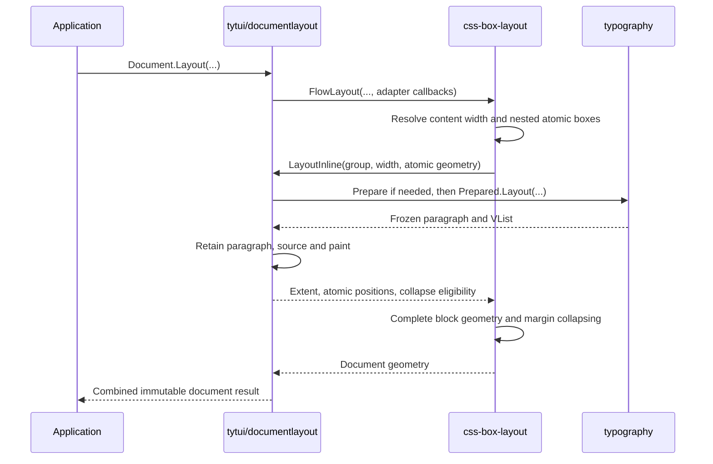

# Document flow and normalized input

Context policy (2026-11-19): typesetting, geometry, retained proofs, replay,
and document execution are synchronous and have no context argument. Contexts
are confined to streaming coordination and font discovery/loading. Streaming
callers create a local background context; consumer failure still cancels and
joins the producer before cleanup. Errors publish no partial result and preserve
previous immutable output. TUI layout jobs finish serially; stale results are
discarded, while font work remains cancellable. This supersedes earlier
cancellation requirements for typesetting in this document.

`documentlayout` implements pipeline integration stages 3D–3F and 4C–4D,
with stage 5 verification complete (2026-11-15). It builds typed CSS
render input from a selected styled block, lets `css-box-layout` normalize the
structure, extracts its anonymous inline groups, and connects `FlowLayout` to
typography's prepared paragraph engine. CSS core schedules and sizes nested atomic
interiors. Geometry, retained paragraphs, sources and paint are published together
after whole-document success. No glyph coverage validation or font discovery is added.

Ordinary `<p>` elements work as selected roots and as descendant blocks. The
DOM supplies the standard `block` default; inline groups are derived by normal
box normalization. No paragraph-specific display translation is needed, and
authored display overrides still apply.

The TUI's F7 document experiment now drives this API with F5 OpenType services;
see the [walkthrough](../README.md#document-experiment). It keeps block selection,
CSS-pixel width, breaker and history separate from paragraph mode. Build/layout
run outside Update on the shared serialized scheduler; the UI retains the last
complete result across edits and failed runs. Its inspector reads the retained
box/source/group/placement associations and its `document-*.svg` export delegates
to `WriteSVG` with captured rendering services. The TUI adds no box sizing,
paragraph algorithms or document replay format.

```go
document, err := documentlayout.Build(htmlDocument, selectedNodeID)
// Handle err before using document.
root := document.Root() // borrowed, immutable structural input for CSS core
for _, group := range document.Groups() {
    input, err := document.Extract(group.GroupID)
    // Handle err. input addresses exactly one normalized inline group.
    // Pass input.Text, input.Styles and input.Anchors to ItemizeInline.
    // Resolve the strut from input.Paragraph.Style, not its first text run.
}
```

To lay out a document, prepare fonts with `fontselection.Prepare`, then construct
a `*glyphing.StyleMapper` with `glyphing.NewStyleMapper(selection.Fonts,
coverage)`. For OpenType, coverage is supplied by
`typography/glyphing/adapter/opentype.Services{}`. Pass the mapper through the
existing `documentlayout.Config.Resolver` field and supply a factory returning
fresh exclusive streaming shapers compatible with the selected faces. The caller
supplies fonts suitable for the text; the existing itemizer
checks remain in place pending their separate relocation.

```go
next, err := document.Layout(documentlayout.LayoutRequest{
    Width: 640, // containing-block width in CSS pixels; zero is valid
    Breaker: paragraph.KnuthPlass,
}, documentlayout.Config{Resolver: resolver, NewShaper: newShaper})
if err != nil {
    return err // retain the previous complete snapshot
}
current = next // publish only the whole successful document
```

`Result.Document()` retains the immutable normalized input. `Geometry()` returns
a detached CSS geometry map; `Groups()` lists the source-order group identities;
`Group(BoxID)` returns a detached `GroupResult` containing extracted `Input` and
the concrete `paragraph.Result`. Its `Input.OwnerID` identifies the content origin
for paragraph placement. Nested callbacks execute before containing callbacks,
but retention is keyed by group BoxID, not callback order. Every prepared atomic
BoxID is mapped through `AtomicSources` and placed exactly once, including zero
sizes. Repeated callbacks fail explicitly; speculative layout is unsupported.

Frozen paragraphs and vlists are shared immutable objects. Mutable result
envelopes, source/paint/layout slices and paragraph diagnostics are copied by
accessors. No preparation handle or partial invocation table escapes. Each call
constructs fresh working state; a failed resize cannot modify an older snapshot.
Keep the tree and font/scale services stable, and serialize layouts sharing a
resolver. Typesetting and CSS flow are synchronous and context-free; contexts
remain confined to font loading and internal streaming coordination.

## Reusable paragraph material and frame flow

Typography's `Prepared` now privately retains immutable SoA `khipu.Khipu` material
and matching `Discovery`. Measurements and layouts share complete discovered
replacement batches. Each layout binds copied atomic advances and selects an
independent immutable `Tikray`; freezing uses that trial's captured geometry.
Applications continue to call `Prepare`, `Prepared.MeasureIntrinsic`,
`Prepared.Layout`, `Prepared.StartFlow` and `Continuation.Fit`, without handling
these private engine objects or exposing a public speculative-trial API.

Keep preparation invocation-local and serialize calls sharing a mapper/services.
Final child callbacks release their preparation. Frame flow retains root
preparation and continuation only until completion, frame exhaustion or failure;
results retain frozen fragments, source/paint and surrounding margins, never
working handles. Equal widths reuse geometry without additional services or
breaking. Different widths lock the accepted prefix and search only the suffix,
then fully freeze/assemble with original paragraph styles and bidi context.

[The PR 3 migration record](../../typography/doc/REFLOW_PR3.md) records the complete
cross-module validation baseline. Replay remains version 5 and does not serialize
Khipus, Tikrays or checkpoints. General registers, page trials and concurrent
execution remain deferred.

## Call flow: CSS initiates paragraph layout

CSS core triggers paragraph boxing through the `InlineLayouter` callback and
receives the geometry needed to continue block layout. The application starts the
whole document operation; it does not create all paragraph VLists beforehand and
then submit them to CSS. Here `documentlayout` is the headless integration adapter
used by `tycli` as well as the TUI. The TUI event loop does not participate in these
callbacks.



1. **The application starts document layout.** `Document.Layout` resolves CSS
   used values and calls `FlowLayout`, supplying an adapter implementing
   `InlineLayouter` and `IntrinsicMeasurer`. See [layout.go](layout.go).
2. **CSS core requests paragraph layout.** When it reaches an inline group, it
   supplies the available content width, resolved box values and prepared
   inline-object dimensions. This callback is the trigger for paragraph boxing.
   See [CSS block layout](../../css-box-layout/layout/layout.go).
3. **The adapter translates the request into typography inputs.** It connects
   the group to text, styles and font services, converts units, and invokes
   `Prepared.Layout`. Typography performs line breaking, freezing and VList
   assembly. Line boxes include their effective ascent/descent and half-leading;
   successive boxes abut at `next.Top = current.Top + current.Height`.
   See [preparation.go](preparation.go) and
   [paragraph layout](../../typography/glyphing/paragraph/prepared.go).
4. **The adapter returns the geometry CSS needs.** `InlineResult` contains
   paragraph extent, inline-object positions and whether the group permits
   margin collapsing. Detailed VLists, glyphs and source/paint associations stay
   retained by the adapter. See the [callback contracts](../../css-box-layout/layout/interfaces.go).
5. **CSS completes the surrounding block layout.** It accounts for padding,
   borders and collapsed block margins without restacking paragraph lines. After
   CSS returns successfully, the adapter publishes document geometry and retained
   paragraphs together.

For automatic widths, CSS can first call `MeasureInline` to obtain intrinsic
widths. That prepares horizontal content without creating the final VList; the
subsequent layout callback reuses the preparation. CSS controls recursive sizing
and the order of nested callbacks. See [measure.go](measure.go).

The adapter connects two contracts: CSS works with document boxes and CSS pixels;
typography works with prepared text, font services and typographic geometry.
`documentlayout` supplies the translation and retains the combined result. CSS
controls when layout is requested; typography controls how the paragraph is
typeset.

There is no architectural requirement that this adapter live in the `tytui`
module specifically. It could be extracted into a reusable integration package
while preserving this call flow. Such extraction is not part of the current API.

## Recovering paragraph items and margins

`Result.Unbox(groupID)` returns a detached `UnboxedParagraph` with `Source` pointing
to the immutable document result, `List` holding a typography `ElasticVList`, and
`Margins` holding a detached `SurroundingMargins` snapshot. It does not measure,
reshape, rebreak, render or rerun CSS. The call is synchronous without a context
argument; invalid input/geometry returns nil and an error preserving its cause.

Each VItem contains a full-height measured line in local coordinates and retains
frozen horizontal content directly. Source/paint associations remain available
through the document result; original VList placements and proofs stay unchanged.
Inline objects stay within their frozen lines, with translated atomic origins.

`Result.SurroundingMargins(groupID)` returns `(SurroundingMargins, bool)` by value.
The snapshot records the enclosing OwnerID and all four signed, uncollapsed
resolved margins in native CSS pixels. Layout captures these from the final
callback's used-values view, including descendants whose margins become definite
only after auto sizing. It retains no CSS callback view or used-values table.
Snapshots are published only with successful groups and whole-document completion.
They preserve fractional values without converting to DU, and later layouts leave
older values unchanged.

Every group produced by Document.Layout has a snapshot, even if all margins are
zero or the paragraph has no lines. Unknown groups/missing metadata return false;
the UnboxedParagraph margin pointer is nil when metadata was not retained, never
an invented all-zero record. Margins belong to the enclosing owner and are not
added to each line. Re-resolve them through CSS if their resolution context changes.

Restacking, target-height packing, stretch/shrink, page-edge margin policy and
rendering the recovered items remain deferred. Existing rendering and replay
continue to consume the original completed results. See the
[unboxing contract](../../typography/doc/VLIST_PLAN.md).

## Preparation and document execution

Stage 4C separates three invocation-local tables: completed group preparations,
accepted final paragraphs, and final-callback attempts. A private helper validates
both the normalized group node's identity and OwnerID before extracting,
itemizing and preparing it once. Cache hits perform the same identity check.
The retained extraction supplies the same anchors, source maps, paint, isolates
and inherited owner context to measurement and final layout. Markup is consumed
during preparation; CSS request views and measurement answers are not retained.

Repeated measurement with different atomic ranges recomputes widths through the
same prepared paragraph, without accepting a final callback. Final callbacks still
allow only one attempt per group, including failed attempts. Failed preparations
are not inserted and can be retried; completed preparations may survive another
callback's failure until the invocation is discarded. No private preparation is
published. Independent `Document.Layout` calls prepare afresh; there is no cache
on `Document` and no cross-invocation resize reuse. Operations sharing an invocation
or prepared handle remain serialized under stable tree/service lifetimes.

Stage 4D connects the invocation as both `InlineLayouter` and `IntrinsicMeasurer`.
`MeasureInline` gets each atomic occurrence's intrinsic border bounds and resolved
horizontal margins from CSS views. It converts each primitive independently to DU,
checks completed signed sums, and delegates to the cached prepared paragraph.
Border bounds already contain padding/borders; neither those edges nor owner edges
are added again. Only the final nonnegative intrinsic summary is converted back
to CSS pixels, with finite-domain and float32-narrowing checks.

CSS core recursively measures atomic interiors, selects shrink-to-fit widths and
resolves descendants before final callbacks. Tytui does not recurse or choose
widths inside its callbacks. Fixed-width flow makes no intrinsic callbacks and
still prepares on demand. Failed measurement publishes no document; completed
private preparations are discarded with the failed invocation. Intrinsic widths
describe natural break opportunities, not breaker fit guarantees: the existing
zero-skip Knuth–Plass policy can select overfull output even at min-content width.

The callback uses normal `CSSLineHeight`, the explicit owner's typography for the
strut, `NoHyphenation`, `AlignBottomMarginEdge` and zero horizontal side skips for
both breakers. Fixed-pixel and auto-width inline-blocks are supported. Positive
overfull output is valid; unsupported negative completed line widths are errors.
Empty atomic interiors have zero content height; the atomic box still participates
in its containing line, whose nonempty line retains the owner strut.

The document hyphenation policy is fixed, not inferred per run. `Build` accepts
default/`hyphens:manual` text without U+00AD, but rejects authored soft hyphens
under effective manual with `khipu.ErrUnsupportedPolicy`. The error identifies
the `NoHyphenation` profile, DOM text-node path and zero-based byte offset in the
decoded text, before whitespace normalization. It rejects independent of width,
including inside nested inline-blocks. Effective `hyphens:none` explicitly
disables discretionary breaks and permits U+00AD: source bytes remain intact,
the marker stays invisible, and ordinary wrapping remains enabled. Values come
from w3c-dom's cascade/inheritance, including ancestors outside the selected root;
unselected sibling text is not validated. `hyphens:auto` remains unsupported.
For example, `<div style="hyphens:none">ab&shy;cd</div>` can be built; the same
content with manual/default cannot. Measurement and final layout share the same
prepared policy; the independent paragraph pipeline and replay are unchanged.

Convert each CSS border dimension and margin separately with
`round(px * 49152)` (ties away from zero), checking the finite DU domain before
casting. Derive advances only after conversion. `dimen.PX` is not a CSS-pixel unit.
Paragraph geometry stays float64 big points. Only CSS-facing extents and border
origins use `points * 4/3`, checked before and after float32 narrowing. The error
budget is half a DU per primitive plus float32 rounding at the CSS boundary.
CSS core retains its original prepared border dimensions, without a DU round trip.

Paragraph and atomic origins are relative to the owner's **content** origin.
CSS geometry uses `RelativeTo` content-coordinate parents. A future document
renderer must compose those origins once and use retained line/material positions;
it must not add owner edges twice, restack lines, or remeasure text. The diagnostic proof below implements those transforms; it is not a full CSS
painting or stacking-context model.

`Group` contains the actual `GroupID`, `OwnerID` and inherited paragraph
`NodeSource`. Anonymous owners inherit the nearest source block's paragraph
context. Split inline boxes retain one source `NodeID` but have distinct BoxIDs.
DOM IDs and paths are locators, not normalized box identities. CSS NodeIDs use
DOM preorder ID + 1, reserving zero for anonymous boxes; callers use `NodeSource`
and `TextSource` lookups rather than depending on that encoding.

`InlineGroup` contains normalized UTF-8 `Text`, complete document `Styles`,
separate `Paint`, typed `LineLayout`, zero-byte `Isolates`, atomic `Anchors`,
`TextSources`, and `AtomicSources`. Every range uses the same emitted byte stream.
Each inline-block emits one U+FFFC OBJECT REPLACEMENT CHARACTER; its entire subtree
is skipped by the containing extraction. Its own normalized groups appear
separately in `Groups()`, including empty and nested atomic interiors. Atomic IDs
are nonzero occurrence IDs local to one group, assigned in emission order.
`AtomicSource` supplies the explicit AtomicID-to-BoxID association and original
element locator. Unattached literal U+FFFC remains ordinary source text.

Text provenance addresses **decoded DOM text-node bytes**, including entity
decoding, not offsets in HTML markup. `TextSpan` also identifies its normalized
text BoxID. Normal whitespace is collapsed across nodes and trimmed at group
edges; atoms count as content. Collapsed space uses its first source unit's style,
paint and bidi scope, matching `htmlinput.Extract`. Several source spans may map
to one collapsed output space; omitted whitespace has zero output width. Atomic
marker ranges are covered only by `AtomicSources`, never invented text-node bytes.
Use both tables when accounting for output coverage.

`htmlinput.Document.ResolvedStyles` supplies existing typography, relative font
sizes, language and direction. `paragraphtext.Normalize` supplies the whitespace
transform, and `htmlinput` supplies isolate markup construction. The paragraph
extractor shares normalized display resolution; extraction and replay data
formats are unchanged.

Initial policy is bounded:

- Select a supported `block flow` or `block flow-root` element (`display:block` or
  `display:flow-root`). Descendants may be supported block, flow-root, inline or
  inline-block elements. Hidden content, explicit breaks, replaced
  elements (except the explicit diagnostic leaf below), tables, list-item and other display modes are rejected.
- Inline-block and block widths may be definite nonnegative px or auto.
  Box margins, padding and visible border widths use px (unitless zero is
  accepted); margins may be signed/auto. CSS core distributes normal blocks'
  horizontal auto margins after widths, padding and borders are resolved. It
  keeps inline-block and vertical auto margins zero and resolves overflow using
  the LTR right-margin rule. Font sizing retains htmlinput's existing
  relative and absolute-unit support. CSS geometry remains in CSS pixels; the
  callback performs checked px/DU conversion at the paragraph boundary.

- Normal whitespace, normal line-height, normal/isolate bidi, static flow and
  ordinary spacing/wrapping are supported. Height/min/max constraints, floats,
  automatic hyphenation and richer policies are rejected. Border width/style
  longhands and their supported four-side shorthands work; the existing DOM
  parser does not support the combined `border` shorthand.
- Ordinary inline edges must be zero. Empty wrappers without edges produce no
  line regardless of font. Coincident nested bidi
  boundaries remain unsupported by the existing zero-byte markup contract.
- `LineLayout` contains normal values over emitted ranges, including markers;
  paragraph assembly uses atomic geometry instead of applying text leading there.

Display decisions use `htmlinput.Document.Display`, backed by w3c-dom's
`css.GetDisplay`. Legacy and multi-keyword spellings normalize identically;
CSS defaults, inherit/initial/unset, and invalid-declaration filtering are owned
by w3c-dom. Winning revert/revert-layer values return source-located errors that
preserve `css.ErrUnsupportedDisplayCascade`. `Document.Property(id, "display")`
continues to expose the original resolved spelling for inspection.

The adapter explicitly projects supported outer/inner pairs into
`css-box-layout.RenderNode.Display`; text nodes leave display zero. It neither
parses display strings nor supplies `Styles["display"]`. The obsolete w3c-dom
bitmask display API and CSS core string accessor/tree-view proposal are removed. Valid but unsupported
values (including list-item, contents, flex/grid, table/ruby and run-in) fail at
this boundary with a DOM locator. The existing hidden-content rejection policy
also applies to normalized `none` values; no subtree is silently discarded.

Block flow-root retains normal block widths and outer margin participation.
CSS core's `EstablishesBFC` contains descendant margins, preserving sibling
collapse inside and outside the boundary. Tytui does not reproduce those rules.
Inline flow-root remains atomic inline-block, including its existing sizing and
paragraph callbacks. Floats and other unsupported layout policies remain rejected.

Build consumes a stable `htmlinput.Document` and retains detached source/style
values, not its DOM pointers or mutable slices. The caller may release that input
after success. `Root()` and everything reachable from it must remain read-only.
Other accessors return values or detached slices; each extraction returns new
caller-owned slices. `BidiMarkup()` snapshots isolate boundaries. Cancellation or
failure returns no partial document/group; synchronous style resolution, CSS
normalization and whitespace transformation retain their cancellation limits.

Tests cover split/hoisted structure, inherited anonymous-owner contexts, nested
and object-only groups, transformed byte correspondence, literal markers,
multibyte entities, isolate boundaries, styles/paint/layout alignment, typed box
edges, source removal and detached outputs. Text-only fixtures are compared with
the established extractor. A synthetic typography/paragraph composition test
checks both breakers and explicit owner struts without adding coverage policy.
Callback tests cover nested scheduling, exact edge/margin accounting, anonymous
owner/ancestor transforms, zero-sized prepared boxes, zero available width,
overfull output, signed margins, unquantized CSS border sizes, conversion limits
and rounding budgets. Late backend failure, late cancellation, publication-time
cancellation, repeated callbacks, detached accessors and resize exercise the
transactional ownership contract. Paragraph mode and replay remain controls;
`../document_workbench_test.go` now covers the document TUI wiring.

## Bounded paragraph frame flow (P5)

`Document.LayoutFlow(FlowRequest, Config)` is an opt-in alternative to
`Layout`. Select a block whose normalized root contains one direct inline group.
Other block siblings/multiple paragraphs are rejected. Opaque inline-blocks need
fixed pixel widths; their retained children keep the original CSS layout. Auto or
percentage inline-block widths and region-dependent object sizing are excluded.

```go
flow, err := document.LayoutFlow(documentlayout.FlowRequest{
    Layout: documentlayout.LayoutRequest{Width: 220, Breaker: paragraph.FirstFit},
    Frames: []documentlayout.FlowFrame{
        {ID: "A", X: 10, Y: 10, Width: 200, Height: 100},
        {ID: "B", X: 250, Y: 10, Width: 150, Height: 400},
    },
}, config)
// This example expects 20 CSS px of horizontal owner edges in the source layout.
```

`Layout.Width` is the original CSS containing width. CSS resolves the owner edges
and fixed children; the single root callback must have the same content width as
frame A after DU rounding, or the request fails. The callback starts flow once.
Frame rectangles are already usable **content** areas in CSS pixels, with finite
float64 coordinates and nonnegative dimensions, including zero. IDs are nonempty
and unique. Width conversion checks before integer casting; origins/heights remain
fractional big points after the 3/4 conversion. Frames have no typography fields.
Original paragraph styles, language, direction, paint and line-height remain fixed.

Each frame is visited once. Equal widths reuse frozen geometry; changed widths
use checkpointed first-fit continuation, even after a Knuth–Plass initial layout.
`Frames()` returns detached `FrameResult` values with `Attempted`, `Reused`,
`Status`, `Breaker` and placed-line `Overfull` diagnostics. Unused destinations after
completion have `Attempted=false`. No-progress frames do not discard content.
`Complete()` and `Remainder()` distinguish successful exhaustion from full placement.
Incomplete results retain frozen material for inspection, not resumable working
state; extending the request requires a new invocation.

Preparations of fixed child paragraphs are removed after their final callbacks.
The root preparation/token lasts only through flow, is removed immediately on
completion, and is also released on failure or frame exhaustion.
No working handle is published. `Group()` detaches original input/source/paint
associations; `SurroundingMargins()` preserves the original owner metadata.
Frames do not reapply these margins or repeat owner decorations at page boundaries.

`BuildFlowProof` inspects placed fragments, including incomplete flows.
`WriteFlowSVG` requires completion and honors `LayoutSVGOptions`: frame/line/child
outlines by default, optional glyphs, or glyphs without diagnostic outlines.
Boxes-only export never queries outlines, identity or line metrics. Export
performs no layout. Proof/serialization failure writes no bytes; writer failures
have the ordinary partial-write contract. CLI file replacement remains atomic.
The ordinary document path and replay v5 are unchanged; there is no flow replay.

The synchronous upstream bidi preparation limitation remains: a deadline cannot
interrupt that resolver. This opt-in experiment does not claim arbitrary mixed-bidi
production support. P6 validates this bounded profile; see the
[production cost report](../../typography/doc/FLOW_COSTS.md) for evidence and
verification scope. The upstream bidi fix, generalized pagination and flow replay
remain deferred.

## Positioned fragment proofs (P4)

`BuildFragmentProof(result, placements, services)` and `WriteFragmentSVG`
render explicit `[]PositionedFragment` drawing requests alongside ordinary
whole-document proofs. Each value supplies a `GroupID`, immutable `Fragment`,
`FrameOrigin` and `Offset`. Origins/offsets use float64 big points, Y downward;
their sum positions the local fragment, with margins/edges already accounted for
by the application. The old owner's CSS content origin is not added again.

```go
placements := []documentlayout.PositionedFragment{{
    GroupID: groupID, Fragment: placed,
    FrameOrigin: render.Point{X: 200, Y: 30},
    Offset: render.Point{X: 4, Y: 8},
}}
proof, err := documentlayout.BuildFragmentProof(current, placements, services)
err = documentlayout.WriteFragmentSVG(writer, current, placements, services)
```

Only published line ranges and their atomic subtrees are drawn. Fragments may
have different frozen owners after width changes; their whole source text must
match the retained group. Callers keep that group's original styles, paint and
fixed atomic dimensions. Child interiors retain their completed CSS layout;
precise atomic border origins and retained content edges are composed once,
including nested objects, signed advances and diagnostic leaves/images.
Ancestor boxes outside those interiors are not repeated in each frame.

Glyph/source/paint identities stay original. Glyph and atomic line indexes are
local to each supplied fragment (or complete opaque child paragraph). Input order
is drawing order; the API neither sorts by X nor schedules frames. Repeated
placements deliberately draw again; omitted ranges are allowed for inspection.
Empty ranges draw nothing and contribute no bounds. Outputs own their slices and
share only immutable image payloads; preparation and continuation handles are
unnecessary. Errors return no partial proof or SVG bytes; writer
failures can leave partial bytes. Ordinary `BuildProof`/`WriteSVG`, replay and CLI
behavior are unchanged. The P4 proof API only renders supplied placements; it
does not schedule frames. Frame scheduling and flow results are implemented by
`Document.LayoutFlow`, with CLI support through `--frames`; see
[Bounded paragraph frame flow (P5)](#bounded-paragraph-frame-flow-p5).
Proof construction performs no shaping, metrics, binding, breaking or restacking.

## Retained document proof

```go
services := render.Services{Backend: backend, Identity: identity}
proof, err := documentlayout.BuildProof(current, services)
// Handle err. proof is detached absolute geometry in float64 big points.
err = documentlayout.WriteSVG(writer, current, services)
```

`typography/render.BuildParagraphProof` owns the reusable frozen-glyph walk,
visual fragment ordering, original UTF-8 paint anchors and outline positioning.
The existing paragraph SVG delegates to that same walker without changing its
public proof records or replay evidence. `documentlayout` adds content-parent
transforms, CSS border/content rectangles and original DOM source correspondence.
No style resolution, font loading, metric query, shaping, breaking or line stacking
occurs while constructing a proof. Caller-supplied identity/outline services must
remain usable for the retained faces. No backend is selected implicitly.

`Proof.Glyphs` contains GroupID, OwnerID, line/knot indexes, glyph/cluster IDs,
original group-relative SourceByte, font hash, paint and covering TextSpan records.
For identity spans, DOM byte = NodeStart + SourceByte - Start; collapsed spans
retain all corresponding source records and require their transform semantics.
`Proof.Atomics` retains the separate element/BoxID/AtomicID association and precise
paragraph border origin. `Proof.Boxes` preserves CSS core dimensions. Small
quantization differences between precise paragraph origins and CSS summaries
are expected under the documented conversion budget. Signed positions remain
signed; rendering never sorts items by X.

Proof construction returns no partial object on error. SVG generation
buffers a complete proof before writing; destination write failures can still leave
partial bytes. The SVG shows diagnostic geometry and glyph outlines in source-group
order, not CSS paint order for overlapping/positioned/stacking contexts. There are no
background/border paint semantics, image layout, font embedding or document replay.

See [the fixture and reproduction commands](testdata/README.md) and
[the sample SVG](testdata/nested-firstfit.svg). Tests check a typed nested tree,
independent synthetic ancestor/multiline/bidi coordinates, both breakers, the real
nested HTML/CSS fixture, retained source/paint after DOM removal and resize, and
Latin ligature/pointed Hebrew glyphs against existing independent HarfBuzz captures.
No new glyph coverage validation is introduced; relocation of existing itemizer
checks remains deferred. Auto-width tests cover intrinsic bounds, signed margins,
primitive rounding, shrink-to-fit below/inside/above the intrinsic interval,
preparation reuse, late measurement failure and unchanged fixed-width
flow.

Stage 5A adds nested scheduling evidence through the actual paragraph engine with
both breakers. The test observer retains callback value snapshots, checks that
all required measurements precede final layout and all used values are definite,
and verifies completed atomic interiors before parent delegation. Fixtures cover
nested auto/fixed boundaries, auto descendants behind fixed boundaries, siblings,
block/anonymous descendants, and empty/object-only groups. Actual `Shape` calls
are counted separately from stream factories, including a group with three shaping
runs. Measured preparations keep their identity and do not reshape during final
layout; fixed boundaries supply equal intrinsic border bounds without measuring
their interiors solely for those bounds. An entirely fixed tree still makes no
intrinsic callbacks. This requires no production API or algorithm changes.

Stage 5B adds independent nested geometry oracles in `nested_geometry_test.go`.
Typed CSS input and equivalent HTML exercise public `Document.Layout` with both
breakers at zero, narrow, intermediate and wide widths. Hand-calculated expectations
cover nested shrink-to-fit, signed margins, border/content rectangles, paragraph
targets and advances, retained baselines, and absolute atomic/glyph transforms.
Empty interiors have zero line height; a mixed fixed/auto fixture checks text
neighbors, block stacking and anonymous owners. Line choices may differ by breaker.

The fractional fixture preserves an inner 4.5 DU CSS border while independently
rounded border/margins give `5 - 1 + 2 = 6 DU`; the outer advance is
`9 + 2 + 2 = 13 DU`. CSS dimensions stay unquantized, paragraph geometry stays
float64, and each CSS narrowing/composition has an explicit half-ULP error budget.
Positive overflow remains accepted; negative completed lines return an error and
no document. Synthetic proof services check numeric transforms without adding
real-font fixtures or production changes.

Stage 5C adds nested resize/failure lifetime sequences in `lifetime_test.go`.
Both breakers run wide success -> narrow success -> failed/cancelled invocation
-> wide success. Immutable value snapshots check all earlier results after each
later operation: CSS geometry, source/style/paint, frozen glyphs/clusters and
source bytes, diagnostics, vlist geometry and atomic identities/placements. The
repeated wide result reproduces the first result, while stream and actual shaping
counts establish fresh preparation per independent document invocation.

Deterministic errors occur during later intrinsic preparation and
parent assembly after a child completes; publication cancellation occurs only
after every paragraph exists privately. Failures preserve their causes and return
no public document. A failed final attempt still rejects a repeated callback.
Fault services use a separate resolver so earlier results keep stable services.
Accessor mutation and destruction of the original HTML input envelope leave
retained results intact; their normalized document remains available for fresh
layout. Frozen/vlist objects and the normalized tree remain read-only. No production
changes, concurrent-use guarantee or cross-invocation preparation cache are added.

Stage 5D adds [nested-auto proof fixtures](testdata/README.md) at containing widths
420/100 CSS px under both breakers, using the existing generator and explicit
Gentium Plus/Noto Sans Hebrew test fonts. The fixture combines nested auto/fixed
items, empty material, signed margins, anonymous/block owners, ligatures, multibyte
text, pointed Hebrew and paint. The four SVGs display retained geometry, including
positive overflow; they are diagnostics, while stage 5B supplies sizing oracles.

`auto_proof_test.go` verifies decoded source anchors, paint, atomic ownership and
exact transport of retained lines and placements through ancestor transforms.
For both breakers, older wide/narrow proofs and SVG bytes remain identical after
later successful and failed/cancelled layouts, destruction of the original HTML
input and mutation of detached accessors. Fresh wide layout reproduces the first
proof. Test-only guards reject preparation services and line-metric queries during
rendering while observing retained outlines, identity and scale conversion. The
existing frozen/vlist walker needs no prepared owner or breaker configuration.
No production API changes, new coverage validation, font copies or replay changes
were needed; the fixed-width proof remains unchanged.

Stage 5E completes cross-module documentation alignment and validation
(2026-11-15). Ordinary and race suites, build and vet passed in khipu, typography,
tytui and css-box-layout, including generic dependency audits, OpenType adapter
regressions and unchanged retained proof/replay controls. No production changes
were needed for stage 5 verification. See the
[implementation record](../../khipu/doc/PIPELINE_INTEGRATION.md) and
[CSS integration evidence](../../css-box-layout/doc/Document-Layout-Integration.md#7-bounded-integration-evidence).

Completion applies to the bounded profile above. Cross-invocation/global caches,
speculative or repeated final callbacks, percentage/relative-length expansion,
full baseline/inline-fragment policies,
outer RTL/vertical writing, full CSS painting, pagination and document replay
remain separate work. The generic khipu/typography explicit
measurement API does not enable CSS hyphenation here; automatic intrinsic
hyphenation and successive textbox splitting remain deferred. Glyph coverage
stays caller-owned; relocating existing itemizer checks is still a future task.

Horizontal block auto margins were added upstream after stage 5 (2026-11-15).
`auto_margin_test.go` verifies independent positions, parent content coordinates,
paragraph widths, paint/provenance and retained resize results under both breakers.
It also centers a fixed-width block inside a measured auto-width inline-block;
CSS core finalizes those margins only after choosing the containing width.
No margin computation is duplicated in the adapter. The root remains at (0,0),
while child blocks are positioned using their resolved left margins.

`hyphenation_test.go` covers the document policy guard, inherited/initial/unset
and priority values, source-located errors, selected-subtree scope and the
separate paragraph extractor. Both breakers verify disabled soft hyphens through
fixed-width and measured auto-width layout, freezing and glyph proofs, including
invisible markers, original bytes, source anchors and bypass colors.
Follow-up verification (2026-11-15): the full tytui ordinary and race suites,
build and vet passed, including existing paragraph/replay and proof controls.

## Explicit diagnostic leaf

Try `testdata/rectangle.html` in the F7 document experiment. An
``
emits one attached atomic occurrence, with no text or paragraph interior.
Only inline/inline-block display and explicit nonnegative CSS-pixel width/height
are supported (zero is valid). Padding, borders and signed margins use the existing
CSS rules. Unmarked images, `src`/`srcset`, HTML width/height attributes and auto
leaf dimensions are rejected; no resources are fetched. Local images use the separate opt-in image marker below; failures are never
replaced by rectangles.

CSS core snapshots `RenderNode.Replaced` and owns intrinsic/final border sizing.
Tytui keeps the immutable alt label separately; `RectangleLabel` and `Proof.Leaves`
expose diagnostic payload/source identity. SVG renders the content rectangle from
retained absolute geometry. Empty inline-block interiors and replaced leaves have
no internal strut, including at zero size. Existing paragraph mode,
rendering bypass and replay are unchanged.

Explicit-leaf validation (2026-11-15): full ordinary/race suites, build and vet
passed in tytui and css-box-layout; paragraph replay and previous SVG fixtures
remain unchanged.


## Explicit local image payloads

```html

```

The same explicit leaf sizing/display contract applies. PNG and JPEG regular files
are supported; format is detected from bytes, not the extension. `Build` resolves
relative src paths against the directory of `htmlinput.Document.Name`, made
absolute at build time. Headless `Parse` callers should supply the source filename
(or an absolute synthetic filename defining the resource directory). Absolute
local paths are also accepted; percent-encoded filenames are decoded. URL schemes,
network hosts, queries/fragments, data URLs, srcset, SVG/GIF and automatic/aspect-ratio
sizing are rejected. `htmlinput` itself still fetches no linked resources.

Build accepts at most 8 MiB per image and accepts at most 16,777,216 pixels. It checks
headers and decodes the complete file before publication, with cancellation checks
around reading/decoding. Failed reads or decoding return a source-located error
and no document. A zero-sized image still requires a valid payload. Repeated
normalized paths share one byte snapshot within that build; a new build reloads
files and can fail without changing a previous result.

`ImageResource` privately owns the exact bytes; `Info` returns path, MIME, pixel
size and SHA-256, while `Bytes` returns a copy. `Document.Leaf` and `ProofLeaf.Image`
share this immutable resource. Pixel size never supplies layout dimensions.
CSS core, khipu and P remain unaware of image formats, I/O and rendering payloads.

SVG embeds the retained bytes in a data URI and uses `preserveAspectRatio="none"`:
the raster stretches to the explicit CSS content rectangle. Padding/borders and
atomic placement use the existing CSS geometry. Export never reopens the file,
decodes it again or reflows the document. TUI inspection shows retained image
identity, and a failed reload leaves the previous proof exportable. Proof order
remains diagnostic rather than full CSS paint order. Paragraph mode and replay
v1/v2/v3 remain unchanged; this is not a document/image replay format.

`image_test.go` covers both formats, directions and breakers, auto containers,
zero dimensions, copied accessors, source identity, deleted files, damaged/large
payloads, rejected URLs/codecs and retained SVG embedding. The TUI lifetime test
exports a captured result after deleting its file and failing a subsequent run.

Local-image validation (2026-11-15): full tytui ordinary/race suites, build and
vet pass, including paragraph/replay and existing nested-document proof controls.
No upstream API or replay format changed for this extension.

## Block margin collapsing (2026-11-16)

CSS core collapses adjoining sibling and eligible parent/child margins. The
adapter reports `InlineResult.AllowsMarginCollapse` from retained output with no
lines, no height, and no atomic participants. Typography's CSSLineHeight assembly
now produces no line for empty CSS-processed text. Explicit empty paragraphs keep
their principal block boxes, edges and margins; their margins can collapse through
where CSS permits. The standalone paragraph workbench uses ProofCompatibility and
retains its separate empty-line behavior.

Core derives anonymous-box suppression from `ComputedStyle.WhiteSpace`, readable
source ranges (`BuildOptions.ReadText`) and inline edges. There are no adapter
suppression flags. Font differences alone cannot create an empty line. The
adapter supplies computed values and source access without modifying core's tree.
Document extraction uses CSS normal-whitespace transformation with byte provenance;
NBSP and Unicode separators are not treated as collapsible ASCII whitespace.
The document profile still rejects non-normal whitespace and decorated inline
boxes until their text/line layout is implemented; core supports the whitespace
values for box generation without claiming support in an inline layouter.

`whitespace_test.go` covers the checked-in `/tmp/,b.html` fixture, paragraph margins,
both breakers, flow-root/atomic interiors, NBSP and empty paragraphs.
`margin_collapse_test.go` checks signed gaps through empty-block chains, parent
boundaries, auto inline-block interiors, resize/replay and retained real-font proofs.
`margin_permission_test.go` checks line-free permission and missing atomics.

`display_test.go` covers normalized aliases and cascade values, rejected display
models and rollback errors, block flow-root parent/sibling margins, normal auto
widths, nested fixed/auto inline-blocks, empty blocks, source correspondence and
retained SVG geometry through both breakers. TUI candidacy and the CLI use the
same normalized display boundary; the CLI also checks real-font flow-root proofs.
